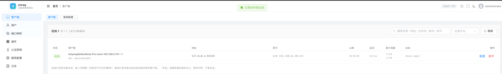

<div align="center">
  <h1>vnray</h1>
  <p>A V2Ray-based reverse proxy for NAT traversal and remote access.</p>
  <p>Expose the network access available to a client and centrally manage multiple egress clients.</p>
  <p>
    <a href="README.en.md"><strong>English</strong></a> ·
    <a href="README.md">简体中文</a>
  </p>
  <p>
    <a href="https://go.dev/"></a>
  </p>
</div>

---

## What problem does it solve?

Many services run inside a home, office, or cloud private network:

- A home connection has no public IP, so a NAS, router, or development environment cannot be reached directly.
- Internal APIs, databases, or SSH services should not be exposed directly to the public Internet.
- Several machines can reach different networks, but users want one public entry point.
- The network only allows outbound connections, making inbound firewall or NAT rules inconvenient.

Typical private-network access solutions usually fall into two categories: **port mapping** and **network overlaying**.

- With port mapping, every client usually needs its own server-side port, and the setup is tightly coupled to the client configuration.
- With network overlaying, users and machines are placed into a virtual network, but the configuration and operational model can be complicated.

### The vnray approach

vnray takes a more focused approach: **one client exposes the network access available to that client**.

The server does not need to enter the private network. It only authenticates users, selects the target client, and forwards their traffic. The client then connects to the destination service from its own network and sends the response back through the tunnel.

Architecturally, this may look like installing a V2Ray server inside the client network and exposing it through a public port mapping. That is not how vnray works internally: the client maintains an outbound tunnel to vnray, and the public server routes user traffic through that tunnel.

> vnray is not a traditional layer-2 VPN that places two machines on the same LAN. It is better suited to request-level routing: **user request → selected client → destination service**.

## Core capabilities

- **Configuration reports** — Immediately after the secure handshake and every 5 minutes, clients report their current configuration and receive the full server configuration. The client Auth frame has been retired.
- **vnray-user inbound** — Native users connect to a separate plugin port configured and enabled in the admin console; internal clients keep using the main port.
- **Client-initiated tunnels** — The server does not need inbound access to the private network, which works well with NAT and outbound-only networks.
- **VLESS / VMess access** — Connect with standard V2Ray clients; the two inbound protocols can be configured with separate ports in the admin console.
- **Shadowsocks access** — Provides an AEAD TCP inbound; the default cipher is `aes-256-gcm`.
- **Port mapping** — Expose a TCP service reachable by the client on a public port, such as SSH, a database, or an internal web service.
  Each mapping tracks cumulative upload (visitor → local service) and download (local service → visitor), also included in client totals. Counts cover forwarded payload only, excluding TLS, tunnel, and encryption overhead. Totals are persisted at the traffic flush interval (10 seconds by default); refresh the mapping list to view them. Editing, disabling, or restarting preserves persisted totals; deleting a mapping removes its totals. An unexpected exit may lose pending increments.
- **Per-client egress selection** — Connect multiple clients to one server and bind different users to different clients.
- **Routing and host mapping** — Configure direct or reject rules, and map custom domains to specific IP addresses on the client side.
- **User egress rules** — The server enforces account rules for vn-v1, VMess, VLESS, and Shadowsocks, with accounts identified by protocol and credential. Rejected destinations never open an exit tunnel. Direct destinations use the bound exit while bypassing its local routing. Mux TCP checks each sub-connection target; mux UDP checks every datagram target. Rule definitions stay on the server.
- **Mux UDP / XUDP** — Supports per-datagram destinations and response source addresses, with up to 64 target/routing combinations per UDP sub-connection. GlobalID does not restore UDP exits across connections; reconnecting may change the NAT source port.
- **Bandwidth and concurrency controls** — Limit upload/download bandwidth and concurrent connections per user.
- **Admin console** — View client online status, latency, traffic, and configuration; manage users, plugins, keys, and port mappings online.
- **Persistent storage** — Supports SQLite and MySQL; the example configuration uses SQLite.

## How it works

```text
┌────────┐        ┌──────────────┐        ┌──────────────┐        ┌──────────┐
│  User  │ ─────▶ │ Public server │ ◀───── │ Private client│ ─────▶ │ Target   │
└────────┘        │ Auth / route │  tunnel  │ Access network│        │ service  │
                  │ / management │        └──────────────┘        └──────────┘
                  └──────────────┘
```

| Component | Typical location | Main responsibility |
| --- | --- | --- |
| **Server** | A machine with a public entry point | Accepts user connections, maintains client sessions, routes requests according to bindings, and serves the admin console |
| **Client** | A private or target network | Connects to the server proactively and accesses services on the local machine or its surrounding network |
| **User client** | The user's device | Connects to the server with VLESS, VMess, or Shadowsocks |

Each in-memory pipe allocates a reusable 64 KiB buffer on its first write. Writers wait when the buffer is full, including writes larger than the capacity. Graceful close preserves buffered tail data. See [ADR 0061](docs/adr/0061-ringbuffer-pipe.md) for the implementation decision.

## Quick start

The steps below use the example configuration included in the repository. For a minimal test, the server and client can run on the same machine. In a real deployment, place the client on a private-network machine that can reach the target service.

Alternatively, download prebuilt binaries from the [GitHub Releases page](https://github.com/hhy50/vnray/releases).

For OpenWrt, [`openwrt/`](openwrt/README.md) provides a client package and LuCI settings with startup management and system logging. Build multi-architecture `.ipk` packages for opkg, or use the matching OpenWrt SDK for apk-based firmware.

### 1. Prepare the binaries

Go `1.26+` is required. The server embeds the Vue admin console, so build the frontend assets before the first Go build:

```bash
cd web/admin
npm install
npm run build
cd ../..
```

Client command handling, configuration assembly, and reconnect logic live in `cmd/client`; the communication runtime lives in `internal/client`. The server entry point is in `cmd/server`, with assembly and service logic in `internal/core`.

`core.initServerApp` explicitly constructs plugins, and `PluginManager` coordinates their state and lifecycle. User bindings, credential caches, and client configuration pushes live in `internal/access`; `admin` provides HTTP management and compatibility aliases for the original binding API. Failed startup rolls back created services. Shutdown stops management writes and new connections, waits for relays, flushes final traffic increments, then closes the database. See [ADR 0051](docs/adr/0051-server-lifecycle-and-control-boundaries.md).

Then build the server and client from the repository root:

```bash
go build -o vnserver ./cmd/server
go build -o vnclient ./cmd/client
```

> `web/admin/dist` contains the embedded admin console assets and is not committed to the repository by default. Run the frontend build again after cloning a fresh copy.

If you prefer to run the source directly, complete the frontend build above first and then run:

```bash
go run ./cmd/server -c configs/server.yaml
go run ./cmd/client -c configs/client.yaml
```

### 2. Start the server

The example server configuration is [`configs/server.yaml`](configs/server.yaml). It uses:

- `9000` for client connections;
- `8080` for the admin console;
- `bindings.db` as the SQLite database;
- `admin/admin` as the example admin credentials.

Start the server:

```bash
./vnserver -c configs/server.yaml
```

### 3. Start the client

On its first database initialization, the server inserts the fixed initial key `2nC7NBBcutpkJg0cPkyQgkzXqtWrri/JB4QyXI5N258=` with scope `*` (all clients). The client example uses the same key. Restarts do not duplicate it, overwrite edits, or restore a deleted key. Databases with existing server settings or keys do not receive this default.

Database startup prepares the schema, then writes the initial key, service settings, default rules, plugin states, and initialization version in one transaction. Any failure rolls back the data and stops startup; the next startup can retry. Existing edits and deletions are preserved, and legacy markers and rule keys are migrated within the same transaction. MySQL schema statements are repeatable but cannot participate in the data transaction. Once initialized, changes to `plugin.enabled` do not seed new records; use the admin console.

For additional keys, sign in at `http://<server-address>:8080`, choose a scope on the **Authentication keys** page, and generate a key to copy into the client configuration. The creation API does not accept manually supplied keys.

Configure `group` and `name` separately; the client reports independent JSON fields, for example `{"group":"office","name":"desktop-01"}`. The server retains `office:desktop-01` as its internal binding key. The admin client list displays group and name separately. An omitted or empty `group` uses `default`. An omitted or empty `name` generates `<hostname>-<IPv4>`; the IP suffix is omitted if no IPv4 address is available. Neither field may contain `:` or `*`. Key scopes accept `*` for all clients, `office:*` for the office group, or `office:desktop-01` for one client. `server:self` is reserved for local server egress.

**Client name upgrade (BREAKING):** The namespace layer has been removed, and legacy `namespace:group:name` names are rejected. Upgrade both ends together and update client names, user bindings, port mappings, per-client settings, and key scopes. Resolve duplicate names across former namespaces before merging groups. Database records are not rewritten automatically. Existing `*` scopes still apply; `X:*` now means group X. Replace legacy three-segment exact scopes with two-segment scopes; the admin console can generate replacement keys for the clients. Split an existing `name: office:desktop-01` into `group: office` and `name: desktop-01`; preserving the full identity requires no server binding or key changes. See [ADR 0062](docs/adr/0062-client-groups.md), [ADR 0063](docs/adr/0063-client-group-config.md), and [ADR 0064](docs/adr/0064-client-report-identity-fields.md). Clients that report only a combined name must also upgrade together with the server; see the [report protocol](docs/PROTOCOL.md).

Edit [`configs/client.yaml`](configs/client.yaml):

```yaml
server:
  addr: <public-server-address>:9000
  auth_key: 2nC7NBBcutpkJg0cPkyQgkzXqtWrri/JB4QyXI5N258=
group: office
name: desktop-01
```

The initial key also works without the admin console. A nonempty managed key table takes precedence over the configuration key. After clearing that table, run `./vnserver keygen` and copy its output into both the server's `server.auth.key` and the client's `server.auth_key` to use the configuration fallback. Keys encode 32 random bytes in standard Base64, and clients are rejected when no valid key is available. Start the client on a machine that can reach the target service:

```bash
./vnclient -c configs/client.yaml
```

The client maintains a long-lived connection and reconnects automatically after a disconnection by default.

The server indexes client keys in memory at startup. Handshake lookup and scope authorization take average O(1) time. Admin changes update the local index immediately; direct database edits or changes made by another server sharing the database require restarting the affected servers to synchronize their indexes.

**BREAKING upgrade:** Update the server and internal clients together. Plaintext internal clients, old passwords, and manually supplied keys in the admin creation API are no longer supported. Generate new managed keys, update clients, and remove old keys; stored credentials are not silently rewritten. Deleting a key rejects future connections. Disconnect existing sessions in the client list to revoke them immediately.

The admin console's **Service configuration → Encrypted transport** switch controls communication after the handshake and defaults to enabled. Enabled connections use ChaCha20-Poly1305 AEAD between TCP and yamux for authentication, heartbeat, configuration and tunneled data. Disabled connections carry plaintext after the handshake, without confidentiality or integrity protection for business data. Both modes require auth_key proof and scope authorization. Clients follow the server automatically. Changes persist and apply to new connections; existing connections adopt the setting after reconnecting.

Both peers contribute random challenges. HKDF-SHA256 and HMAC-SHA256 authenticate the selected mode, and the handshake sends only the public key identifier, never the PSK. Configuration reports carry no key. This PSK design has no forward secrecy, and holders of a shared key belong to the same trust domain. Transport v2 is incompatible with the previous AEAD v1 handshake: update both peers together; existing generated keys remain valid. VLESS/VMess/SS and admin HTTP retain their own protocols. Native `vn-v1` users now use the separate `vnray-user` port; the main port accepts only internal clients. See the [protocol](docs/PROTOCOL.md) and [ADR 0045](docs/adr/0045-negotiated-transport-encryption.md). The report protocol and separate user listener also require both peers to be updated together.

### 4. Open the admin console and create a user

Open:

```text
http://<server-address>:8080
```

Sign in with the configured admin account, then:

1. Open **Clients** and confirm that the client is online.
2. Open **Plugins**, enable the inbound protocol you need, and set its listening port.
3. Open **Users**, create a user, and select the protocol and egress client.
4. Copy the generated connection information and import it into the corresponding V2Ray or Shadowsocks client.
5. If you need to expose a TCP service in the client's network, create a mapping in **Port Mappings**.

<div align="center">
  
</div>

## Ports and protocols

| Purpose | Default port / configuration | Description |
| --- | --- | --- |
| Client tunnel | `9000`, `server.listen` | The port that clients use to connect proactively; it does not directly carry user protocol traffic |
| vnray-user inbound | Set in the plugin page, e.g. `9001` | Separate native user port; disabled until configured |
| Admin console | `8080`, `admin.listen` | Manage clients, users, plugins, and port mappings after signing in |
| VMess inbound | Configured in the admin console; defaults to `11120` | For VMess client connections |
| VLESS inbound | Configured in the admin console; defaults to `11121` | For VLESS client connections |
| Shadowsocks inbound | Configured in the admin console | For Shadowsocks client connections |

The `vnray-user` plugin starts disabled with no preset port. Configure and enable it under **Plugins**, then point native `vn-v1` users to that port. Existing user bindings, internal client addresses, and generated keys remain valid. Revoked keys are rejected on the next periodic report; disconnect sessions in the admin console for immediate revocation.

## Configuration files

- [`configs/server.yaml`](configs/server.yaml): server listener, authentication key, admin console, storage, plugin, and logging settings.
- [`configs/client.yaml`](configs/client.yaml): server address, authentication key, reconnect policy, access controls, and outbound routing settings.

Command-line option:

```text
-c, --config  YAML configuration file; use built-in defaults when omitted
```

The client also supports temporarily overriding the server address from the command line:

```bash
./vnclient -c configs/client.yaml --server <server-address>:9000
```

## Port mapping or protocol access?

- **You want multiple users to connect with standard proxy clients**: create VLESS, VMess, or Shadowsocks users in the admin console.
- **You only need to expose one internal TCP service**: use port mapping, for example to expose an internal SSH service on a public port.
- **You want traffic to leave through a specific network**: bind the user to the corresponding client; one server can connect multiple clients.

## Security

The example configuration is intended for local verification and contains public default admin credentials. Before exposing the service to the public Internet:

- Change the admin username and password.
- Generate client keys and restrict their authorization scope to the intended clients or groups.
- Open only the ports you actually need and restrict access to the admin console.
- Set reasonable bandwidth, concurrency, and client access limits for each user.
- For production use, prefer VLESS with TLS and protect the certificates and private keys carefully.

## Project status

Admin configuration changes are not serialized across requests. Concurrent saves may overwrite one another, and inbound configuration changes may affect or disconnect existing connections. Shared account, authentication, and connection tables use concurrent containers; individual table operations do not make an entire admin operation transactional.

vnray is under active development. Protocols, configuration, and admin console APIs may change. Issues and improvement suggestions are welcome.
