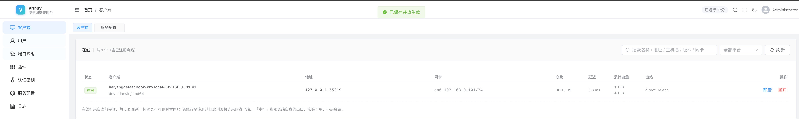

<div align="center">
  <h1>vnray</h1>
  <p>A V2Ray-based reverse proxy for NAT traversal and remote access.</p>
  <p>Expose the network access available to a client and centrally manage multiple egress clients.</p>
  <p>
    <a href="README.en.md"><strong>English</strong></a> ·
    <a href="README.md">简体中文</a>
  </p>
  <p>
    <a href="https://go.dev/"></a>
  </p>
</div>

---

## What problem does it solve?

Many services run inside a home, office, or cloud private network:

- A home connection has no public IP, so a NAS, router, or development environment cannot be reached directly.
- Internal APIs, databases, or SSH services should not be exposed directly to the public Internet.
- Several machines can reach different networks, but users want one public entry point.
- The network only allows outbound connections, making inbound firewall or NAT rules inconvenient.

Typical private-network access solutions usually fall into two categories: **port mapping** and **network overlaying**.

- With port mapping, every client usually needs its own server-side port, and the setup is tightly coupled to the client configuration.
- With network overlaying, users and machines are placed into a virtual network, but the configuration and operational model can be complicated.

### The vnray approach

vnray takes a more focused approach: **one client exposes the network access available to that client**.

The server does not need to enter the private network. It only authenticates users, selects the target client, and forwards their traffic. The client then connects to the destination service from its own network and sends the response back through the tunnel.

Architecturally, this may look like installing a V2Ray server inside the client network and exposing it through a public port mapping. That is not how vnray works internally: the client maintains an outbound tunnel to vnray, and the public server routes user traffic through that tunnel.

> vnray is not a traditional layer-2 VPN that places two machines on the same LAN. It is better suited to request-level routing: **user request → selected client → destination service**.

## Core capabilities

- **Client-initiated tunnels** — The server does not need inbound access to the private network, which works well with NAT and outbound-only networks.
- **VLESS / VMess access** — Connect with standard V2Ray clients; the two inbound protocols can be configured with separate ports in the admin console.
- **Shadowsocks access** — Provides an AEAD TCP inbound; the default cipher is `aes-256-gcm`.
- **Port mapping** — Expose a TCP service reachable by the client on a public port, such as SSH, a database, or an internal web service.
- **Per-client egress selection** — Connect multiple clients to one server and bind different users to different clients.
- **Routing and host mapping** — Configure direct or reject rules, and map custom domains to specific IP addresses on the client side.
- **Bandwidth and concurrency controls** — Limit upload/download bandwidth and concurrent connections per user.
- **Admin console** — View client online status, latency, traffic, and configuration; manage users, plugins, keys, and port mappings online.
- **Persistent storage** — Supports SQLite and MySQL; the example configuration uses SQLite.

## How it works

```text
┌────────┐        ┌──────────────┐        ┌──────────────┐        ┌──────────┐
│  User  │ ─────▶ │ Public server │ ◀───── │ Private client│ ─────▶ │ Target   │
└────────┘        │ Auth / route │  tunnel  │ Access network│        │ service  │
                  │ / management │        └──────────────┘        └──────────┘
                  └──────────────┘
```

| Component | Typical location | Main responsibility |
| --- | --- | --- |
| **Server** | A machine with a public entry point | Accepts user connections, maintains client sessions, routes requests according to bindings, and serves the admin console |
| **Client** | A private or target network | Connects to the server proactively and accesses services on the local machine or its surrounding network |
| **User client** | The user's device | Connects to the server with VLESS, VMess, or Shadowsocks |

## Quick start

The steps below use the example configuration included in the repository. For a minimal test, the server and client can run on the same machine. In a real deployment, place the client on a private-network machine that can reach the target service.

Alternatively, download prebuilt binaries from the [GitHub Releases page](https://github.com/hhy50/vnray/releases).

### 1. Prepare the binaries

Go `1.26+` is required. The server embeds the Vue admin console, so build the frontend assets before the first Go build:

```bash
cd web/admin
npm install
npm run build
cd ../..
```

Then build the server and client from the repository root:

```bash
go build -o vnserver ./cmd/server
go build -o vnclient ./cmd/client
```

> `web/admin/dist` contains the embedded admin console assets and is not committed to the repository by default. Run the frontend build again after cloning a fresh copy.

If you prefer to run the source directly, complete the frontend build above first and then run:

```bash
go run ./cmd/server -c configs/server.yaml
go run ./cmd/client -c configs/client.yaml
```

### 2. Start the server

The example server configuration is [`configs/server.yaml`](configs/server.yaml). It uses:

- `9000` for client connections;
- `8080` for the admin console;
- `bindings.db` as the SQLite database;
- `admin/admin` as the example admin credentials.

Start the server:

```bash
./vnserver -c configs/server.yaml
```

### 3. Start the client

Edit [`configs/client.yaml`](configs/client.yaml):

```yaml
server:
  addr: <public-server-address>:9000
  auth_key: <same-key-as-the-server>
```

The client's `auth_key` must match `server.auth.key` in the server configuration. Start the client on a machine that can reach the target service:

```bash
./vnclient -c configs/client.yaml
```

The client maintains a long-lived connection and reconnects automatically after a disconnection by default.

### 4. Open the admin console and create a user

Open:

```text
http://<server-address>:8080
```

Sign in with the configured admin account, then:

1. Open **Clients** and confirm that the client is online.
2. Open **Plugins**, enable the inbound protocol you need, and set its listening port.
3. Open **Users**, create a user, and select the protocol and egress client.
4. Copy the generated connection information and import it into the corresponding V2Ray or Shadowsocks client.
5. If you need to expose a TCP service in the client's network, create a mapping in **Port Mappings**.

<div align="center">
  
</div>

## Ports and protocols

| Purpose | Default port / configuration | Description |
| --- | --- | --- |
| Client tunnel | `9000`, `server.listen` | The port that clients use to connect proactively; it does not directly carry user protocol traffic |
| Admin console | `8080`, `admin.listen` | Manage clients, users, plugins, and port mappings after signing in |
| VMess inbound | Configured in the admin console; defaults to `11120` | For VMess client connections |
| VLESS inbound | Configured in the admin console; defaults to `11121` | For VLESS client connections |
| Shadowsocks inbound | Configured in the admin console | For Shadowsocks client connections |

## Configuration files

- [`configs/server.yaml`](configs/server.yaml): server listener, authentication key, admin console, storage, plugin, and logging settings.
- [`configs/client.yaml`](configs/client.yaml): server address, authentication key, reconnect policy, access controls, and outbound routing settings.

Command-line option:

```text
-c, --config  YAML configuration file; use built-in defaults when omitted
```

The client also supports temporarily overriding the server address from the command line:

```bash
./vnclient -c configs/client.yaml --server <server-address>:9000
```

## Port mapping or protocol access?

- **You want multiple users to connect with standard proxy clients**: create VLESS, VMess, or Shadowsocks users in the admin console.
- **You only need to expose one internal TCP service**: use port mapping, for example to expose an internal SSH service on a public port.
- **You want traffic to leave through a specific network**: bind the user to the corresponding client; one server can connect multiple clients.

## Security

The example configuration is intended for local verification and contains public default credentials and a shared key. Before exposing the service to the public Internet:

- Change the admin username and password.
- Change the shared authentication key used by the server and clients.
- Open only the ports you actually need and restrict access to the admin console.
- Set reasonable bandwidth, concurrency, and client access limits for each user.
- For production use, prefer VLESS with TLS and protect the certificates and private keys carefully.

## Project status

vnray is under active development. Protocols, configuration, and admin console APIs may change. Issues and improvement suggestions are welcome.
