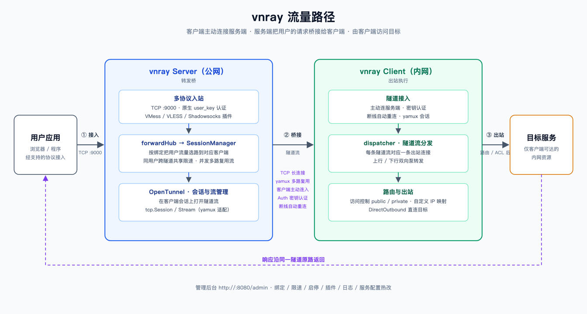

<div align="center">
  <h1>vnray</h1>
  <p><strong>A reverse-proxy data plane for NAT traversal and remote access.</strong></p>
  <p>Connect users to private-network services through a client-initiated tunnel.</p>
  <p>
    <a href="README.md"><strong>English</strong></a> ·
    <a href="README.zh-CN.md">简体中文</a>
  </p>
  <p>
    <a href="https://go.dev/"></a>
  </p>
</div>

---

vnray bridges user requests from a public server to a client running in the target network. The client initiates and maintains the connection, accesses the destination, and returns responses through the same tunnel—without requiring inbound access to the private network.

<div align="center">
  
</div>

## Features

- **VMess and VLESS** — Native protocol support; connect directly with standard v2ray clients.
- **Shadowsocks** — Provide Shadowsocks access alongside v2ray protocols.
- **Port mapping** — Expose services available on the client side through mapped ports.
- **Flexible egress** — Route traffic through any network available to the client.
- **Traffic controls** — Apply per-user bandwidth and concurrency limits.
- **Custom hosts** — Map domain names to specific IP addresses.
- **Live admin dashboard** — Monitor online status, latency, and traffic statistics in real time.

## How It Works

| Component | Typical location | Role |
| --- | --- | --- |
| **Server** | Public network | Accepts user traffic and client tunnels, then bridges requests to the selected client. |
| **Client** | Private or target network | Maintains an outbound connection to the server and accesses destinations on the user's behalf. |

Responses travel back through the same tunnel, so users only need to connect to the server.

## Quick Start

The commands below assume that the `vnserver` and `vnclient` binaries are in your current directory.

### 1. Start the server

Review [`configs/server.yaml`](configs/server.yaml) before starting. The example configuration listens for client connections on port `9000` and serves the admin console on port `8080`.

```bash
./vnserver -c configs/server.yaml
```

### 2. Connect the client

Edit [`configs/client.yaml`](configs/client.yaml):

- Set `server.addr` to the public address of your server, such as `server.example.com:9000`.
- Make sure `server.auth_key` matches `server.auth.key` in the server configuration.

Then start the client on a machine that can reach the target services:

```bash
./vnclient -c configs/client.yaml
```

### 3. Open the admin console

Visit `http://<server-ip>:8080` and sign in with the admin credentials from `configs/server.yaml`. Connected clients appear on the **Clients** tab.

<div align="center">
  
</div>

### 4. Create a user

On the **Users** tab:

1. Select a protocol; **VLESS is recommended**.
2. Select the client to use as the egress.
3. Click **Add**.
4. Copy the generated link and import it into your v2ray client.

> **Security note:** The example configuration includes default credentials and a shared key. Replace the admin password and authentication keys before exposing the service to a public network.
