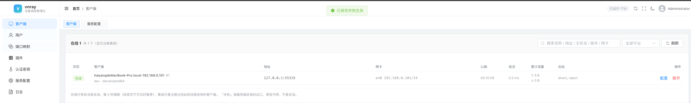

<div align="center">
  <h1>vnray</h1>
  <p>一个基于V2ray协议的内网穿透服务，适合远程访问内网应用、统一管理多台出口客户端。</p>
  <p>
    <a href="README.en.md">English</a> ·
  </p>
  <p>
    <a href="https://go.dev/"></a>
  </p>
</div>

---

## 它解决什么问题？

- 家庭宽带没有公网 IP，无法直接访问 NAS、路由器或家里的开发环境；
- 公司内网的测试 API、数据库或 SSH 服务，不应该直接暴露在公网；
- 多台机器分别能访问不同网络，想从一个公网入口统一接入；
- 只开放出站连接，不方便在防火墙或 NAT 上配置入站端口。

一般的内网穿透实现都是 **端口映射** 和 **组网**

- 端口映射，每个客户端都需要占用服务端的一个端口，并且强依赖客户端的配置
- 组网，主要是配置繁琐

### Vnray

- **Vnray的核心逻辑就是通过一个客户端，把客户端的网络环境暴露出来**
- **他的核心原理就是服务端只负责把用户的流量转发给具体的客户端，最后客户端把流量转发给目标服务**
- 从架构上来看, 它就像是在客户端装了一个v2ray服务端, 然后通过端口映射的形式, 让公网可以访问到客户端的v2ray服务端, 实际上并不是这种实现

## 核心能力

- **客户端主动建隧道**：服务端不需要主动访问内网，适合 NAT 和仅允许出站连接的网络。
- **配置定期上报**：安全握手后立即上报客户端配置，之后每 5 分钟上报并取得服务端全量配置；原客户端 Auth 帧已移除。
- **vnray-user 入站**：用户通过插件独立端口连接，内网客户端继续使用原主端口；在管理台配置端口并启用。
- **客户端链路加密**：使用生成的 `auth_key` 完成双向认证，管理台控制握手后的传输加密，默认使用 ChaCha20-Poly1305 AEAD。
- **VLESS / VMess 接入**：可使用标准 v2ray 客户端连接；管理台可分别配置两个入站端口。
- **mux UDP / XUDP**：支持逐数据报目标和响应来源地址，服务端逐包检查用户规则；每条 UDP 子连接最多复用 64 个目标与选路组合。GlobalID 不用于跨连接恢复，重连可能改变 NAT 源端口。
- **Shadowsocks 接入**：提供 AEAD TCP 入站，添加用户时可选择 `aes-256-gcm`、`aes-128-gcm` 或 `chacha20-ietf-poly1305`，并复制标准 `ss://` 链接。旧用户未指定方法时沿用插件默认值。
- **端口映射**：把客户端侧能访问的 TCP 服务映射到公网端口，适合 SSH、数据库和内部 Web 服务。
  每条映射独立累计上下行流量（上行：访客 → 本地服务，下行：本地服务 → 访客），同时计入客户端汇总。统计仅计转发载荷，不含 TLS、隧道及加密封装开销；按流量落库周期持久化（默认 10 秒），在映射列表刷新查看。修改、停用映射或重启服务保留已落库统计，删除映射时删除其统计；异常退出可能丢失尚未落库的增量。
- **按客户端选择出口**：同一个服务端可以连接多台客户端，并把不同用户绑定到不同客户端。
- **路由与 Host 映射**：客户端可以配置直连、拒绝规则，以及自定义域名到 IP 的映射。
- **带宽与并发控制**：按用户限制上下行带宽和并发连接数。
- **用户出站规则**：规则由服务端保存与判定（配置表键 `rule.<规则名>`），按协议与用户账号绑定，统一作用于 vn-v1、VMess、VLESS 和 Shadowsocks 入站。拒绝名单在建立出口隧道前拦截；直连名单仍走绑定出口，但跳过出口的本地路由。mux TCP 按子连接目标判定，mux UDP 按每个数据报目标判定，规则内容不下发给用户端或出口客户端。
- **管理台**：查看客户端在线状态、延迟、流量和配置，在线管理用户、插件、密钥与端口映射。
- **实时日志**：通过 SSE 增量查看文件日志，支持暂停、续接和关键字过滤；“清空页面”只清除当前页面内容，后续日志继续显示，不修改服务端文件。
- **可持久化存储**：支持 SQLite，也支持 MySQL；默认示例使用 SQLite。
- **服务端出口**: 服务端也可以像v2ray服务端一样，自己负责处理出站流量，而不是只负责转发流量。（默认关闭）

## 工作原理

```text
┌────────┐        ┌──────────────┐        ┌──────────────┐        ┌──────────┐
│  用户  │ ─────▶ │ 公网服务端    │ ◀───── │ 内网客户端    │ ─────▶ │ 目标服务 │
└────────┘        │ 认证/路由/管理 │  主动隧道 │ 访问目标网络  │        └──────────┘
                  └──────────────┘        └──────────────┘
```

| 组件 | 部署位置 | 主要职责 |
| --- | --- | --- |
| **服务端** | 有公网入口的机器 | 接收用户连接，维护客户端会话，按绑定关系转发请求，并提供管理台 |
| **客户端** | 内网或目标网络 | 主动连接服务端，访问本机或所在网络中的目标服务 |
| **用户客户端** | 用户设备 | 使用 VLESS、VMess 或 Shadowsocks 连接服务端 |

单向内存管道在首次写入时分配 64 KiB 缓冲并循环复用；缓冲写满后等待消费，单次大写入也受此上限约束。正常关闭会先读完尾数据。实现取舍见 [ADR 0061](docs/adr/0061-ringbuffer-pipe.md)。

## 快速开始

下面用仓库内的示例配置启动一个最小环境。假设服务端和客户端运行在同一台机器上；实际部署时，把客户端放到能访问目标服务的内网机器即可。

或者下载构建好的二进制文件：[https://github.com/hhy50/vnray/releases](https://github.com/hhy50/vnray/releases)

### 1. 准备程序

需要 Go `1.26+`。服务端会内置 Vue 管理台，因此首次构建前还需要构建前端资源：

```bash
cd web/admin
npm install
npm run build
cd ../..
```

客户端命令行、配置装配和重连逻辑位于 `cmd/client`，通信运行时位于 `internal/client`；服务端入口位于 `cmd/server`，装配与业务实现位于 `internal/core`。

服务端由 `core.initServerApp` 显式构造插件，`PluginManager` 负责状态与生命周期；用户绑定、凭据缓存和客户端配置推送位于 `internal/access`，`admin` 提供 HTTP 管理接口并保留原绑定 API 的兼容入口。启动失败会逆序回收已创建的服务；正常退出先停止管理写入口和数据接入，等待转发退出，完成最后一次流量落库后再关闭数据库。详见 [ADR 0051](docs/adr/0051-server-lifecycle-and-control-boundaries.md)。

然后在项目根目录编译服务端和客户端：

```bash
go build -o vnserver ./cmd/server
go build -o vnclient ./cmd/client
```

> `web/admin/dist` 是服务端构建所需的内置资源目录，且默认不提交到仓库。拉取新副本后需要重新执行一次前端构建。

如果只想直接运行源码，也需要先完成上面的前端构建，然后执行：

```bash
go run ./cmd/server -c configs/server.yaml
go run ./cmd/client -c configs/client.yaml
```

### 2. 启动服务端

示例服务端配置位于 [`configs/server.yaml`](configs/server.yaml)，默认使用：

- `9000`：客户端连接端口；
- `8080`：管理台端口；
- `bindings.db`：SQLite 数据库；
- `admin/admin`：示例管理台账号。

启动服务端：

```bash
./vnserver -c configs/server.yaml
```

### 3. 启动客户端

服务端首次初始化数据库时，会插入固定初始密钥 `2nC7NBBcutpkJg0cPkyQgkzXqtWrri/JB4QyXI5N258=`，范围为 `*`（全部客户端）。客户端示例使用同一密钥。后续重启不会重复插入、覆盖修改或恢复已删除的密钥；已有服务端配置或密钥的数据库不会补入该默认值。

数据库启动时先准备表结构，再在单个事务中写入初始密钥、服务配置、默认规则和插件初始状态，最后提交初始化版本。任何一项失败都会回滚数据并阻止服务启动；下次启动可重试。已有数据库会保留已修改或删除的记录；旧版初始化标记和规则键在同一事务内迁移。MySQL 建表语句自身不参与该事务，但可以重复执行。初始化完成后，修改 `plugin.enabled` 不再补写默认插件记录，后续启停请使用管理台。

需要额外密钥时，打开管理台 `http://<服务端地址>:8080`，登录后在**认证密钥**页面选择范围并生成密钥，复制到客户端配置即可；添加接口不接受手工指定密钥。

编辑 [`configs/client.yaml`](configs/client.yaml)：

```yaml
server:
  addr: <服务端公网地址>:9000
  auth_key: 2nC7NBBcutpkJg0cPkyQgkzXqtWrri/JB4QyXI5N258=
```

不使用管理台时，也可使用初始密钥连接。密钥表非空时只使用表内密钥及其范围授权，配置文件密钥不生效。清空密钥表后，可执行 `./vnserver keygen`，将输出的同一密钥填入服务端 `server.auth.key` 和客户端 `server.auth_key`，作为配置文件回退。密钥为 32 字节随机数的标准 Base64 编码；没有可用密钥时拒绝客户端连接。

然后在能够访问目标服务的机器上启动客户端：

```bash
./vnclient -c configs/client.yaml
```

客户端默认会保持长连接，并在断线后自动重连。

OpenWrt 可使用 [`openwrt/`](openwrt/README.md) 中的客户端插件，包含 LuCI 配置页、开机自启和系统日志，支持 x86、ARM / ARM64、MIPS 大小端等多架构打包。opkg 固件可生成 `.ipk`；apk 固件使用对应 OpenWrt SDK 构建。

客户端密钥在服务端启动时建立内存索引，握手查找及范围授权平均 O(1)。管理台增删密钥即时更新本进程索引；绕过管理台直接修改数据库、或多个服务端共用数据库时，需要重启相关服务端以同步修改。

**升级说明（BREAKING）**：服务端和内网客户端必须同步升级。旧版明文客户端、旧短口令及旧管理台手工添加密钥的 API 均不再支持。升级后先在管理台生成新密钥并更新客户端，再删除旧密钥；不自动改写数据库中的旧值。删除密钥会拒绝后续连接，已建立会话在下次配置上报时重新校验；立即撤销可在客户端列表主动断开。

在管理台「服务配置 → 加密传输」控制握手后的通信模式，默认开启。开启时，TCP 与 yamux 之间使用 ChaCha20-Poly1305 AEAD，保护配置上报、心跳、配置及隧道数据；关闭时，握手后的数据明文传输，不提供业务数据的保密与完整性保护。两种模式都验证 `auth_key` 并执行范围授权，客户端自动跟随服务端，无需新增配置。开关落库，保存后用于新连接，在线连接重连后生效。

握手使用双方随机挑战、HKDF-SHA256 与 HMAC-SHA256，模式选择纳入双向证明；握手仅发送公开 key_id，配置上报不携带密钥，不发送原始 PSK。PSK 方案不提供前向保密，同一密钥的持有者属于同一信任范围。这一开关只覆盖 vnray 内网客户端与服务端：VLESS/VMess/SS 入站、管理台 HTTP 保持各自协议；`vn-v1` 用户使用 `vnray-user` 插件的独立端口，主端口不再接受用户连接。新增开关后的握手版本为 v2，与原 AEAD v1 不兼容，两端需同步升级，生成的密钥可继续使用。详见 [协议说明](docs/PROTOCOL.md) 与 [ADR 0045](docs/adr/0045-negotiated-transport-encryption.md)。配置上报及用户端口隔离也要求两端同步升级。

### 4. 打开管理台并创建用户

访问：

```text
http://<服务端地址>:8080
```

使用配置中的管理员账号登录，然后：

1. 在**客户端**页面确认客户端已在线；
2. 在**插件**页面启用需要的入站协议，并设置监听端口；
3. 在**用户**页面创建用户，选择协议和出口客户端；
4. 复制生成的连接信息，导入对应的 v2ray 或 Shadowsocks 客户端；
5. 如果要访问客户端所在网络中的 TCP 服务，再到**端口映射**页面创建映射。

`vnray-user` 默认停用且没有预设端口；在插件页设置独立端口并启用，再让 `vn-v1` 用户连接该端口（例如 `9001`）。已有用户绑定无需迁移，内网客户端的地址与 `auth_key` 无需改变。

运行中修改插件端口会先准备新监听，准备或保存失败时保留旧监听；未修改的端口和既有连接保持工作。进程退出会关闭并等待存量连接，已启用插件恢复失败则拒绝本次启动。服务会话参数热改同时作用于客户端主端口与 `vnray-user` 端口之后建立的新会话。

SS 用户的分享链接包含所选加密类型和密码，使用服务端配置里的公网地址及 SS 插件监听端口。未配置端口时，复制按钮不可用。

日志页首次显示文件末尾最多 300 行，随后实时追加，页面最多保留最近 1000 行（约 256 Ki 字符）。清空后暂停、恢复或重新连接不会重新加载已清空的历史；重新打开或刷新页面会重新读取日志末尾。日志需写入 `log.output` 指定的文件；若管理台经过反向代理，请允许 `/admin/ops/api/logs/stream` 持续传输并关闭响应缓冲。

在**客户端配置**页面统一设置自定义 Host 和 IP 段映射，保存后立即下发给在线的远程 vnray 客户端，离线客户端在下次连接时获取；服务端重启后仍保留。例如，`youyuevpn4.route → 192.168.60.1` 固定该域名的出站 IP，`186.12.12.* → 192.168.60.*` 会将 `186.12.12.1` 转为 `192.168.60.1`。域名需要由代理请求传给 vnray；浏览器把单段名称当作搜索词、或提前在本地解析时，这里的 Host 配置不会参与。

服务端通过 `client_config` 和 `global_config` 两个独立 key 下发规则，客户端先查独立配置，未命中才查全局配置。IP 映射在每层内取首条命中结果；即使独立规则将 IP 映射为自身，也不会继续查询全局规则或二次改写。例如独立规则 `192.169.30.12 → 10.30.0.12` 优先于全局 `192.169.30.* → 10.60.0.*`，而 `192.169.30.13` 使用全局规则。

客户端编辑页只显示独立配置，删除独立规则即可恢复使用全局规则；清空全局规则并保存只撤回全局值，不删除客户端独立配置。全局客户端配置不作用于本机出口 `server:self`。本次下发 JSON 结构有变更，需同步更新服务端和客户端；旧版不能正确读取新的分层规则，详见 [协议说明](docs/PROTOCOL.md)。

管理台界面支持中文与英文：顶栏右侧的语言按钮即时切换，首次进入按浏览器语言选择，之后记住上一次的选择（`localStorage` 的 `vnray.locale`）。接口返回的提示文案跟随同一语言，通过请求头 `Accept-Language` 协商；未声明或不支持的语言回落中文。

<div align="center">
  
</div>

## 端口与协议

| 用途 | 默认端口 / 配置位置 | 说明 |
| --- | --- | --- |
| 客户端隧道 | `9000`，`server.listen` | 客户端主动连接服务端的端口，不直接承载用户协议 |
| vnray-user 用户入站 | 在插件页配置，例如 `9001` | `vn-v1` 用户的独立端口，默认停用 |
| 管理台 | `8080`，`admin.listen` | 登录后管理客户端、用户、插件和端口映射 |
| VMess 入站 | 管理台配置，默认预填 `11120` | 供 VMess 客户端连接 |
| VLESS 入站 | 管理台配置，默认预填 `11121` | 供 VLESS 客户端连接 |
| Shadowsocks 入站 | 管理台配置 | 供 Shadowsocks 客户端连接 |

## 配置文件

- [`configs/server.yaml`](configs/server.yaml)：服务端监听、认证密钥、管理台、存储、插件和日志配置。
- [`configs/client.yaml`](configs/client.yaml)：客户端连接地址、认证密钥、重连策略、访问控制和出站路由配置。

命令行参数：

```text
-c, --config  配置文件路径（YAML）；不传时使用内置默认值
```

客户端还支持用 `--server` 临时覆盖配置文件里的服务端地址：

```bash
./vnclient -c configs/client.yaml --server <服务端地址>:9000
```

## 什么时候选端口映射，什么时候选协议接入？

- **想让多个用户使用标准代理客户端接入**：在管理台创建 VLESS/VMess 或 Shadowsocks 用户。
- **只想把一个内网 TCP 服务暴露出来**：使用端口映射，例如把内网 SSH 映射到公网端口。
- **想让请求从某台特定网络出口发出**：创建用户后绑定对应客户端；同一服务端可以连接多台客户端。

## 安全提示

示例配置仅用于本地验证，包含公开的管理台默认凭据。将服务暴露到公网前，请至少完成以下操作：

- 修改管理台账号和密码；
- 为客户端生成密钥，并按客户端或 namespace 设置授权范围；
- 只开放实际需要的端口，并限制管理台的访问来源；
- 为用户设置合理的带宽、并发和客户端访问范围；
- 生产环境优先启用 VLESS TLS，并妥善保管证书与密钥。

## 项目状态

管理台配置修改不提供跨请求的串行一致性；并发保存可能相互覆盖，修改入站配置可能影响或断开已有连接。共享账号、认证记录和连接表使用并发容器，单项读写不等于整个管理操作具有事务性。

vnray 仍在持续开发中，协议、配置和管理台接口可能发生变化。欢迎通过 Issue 反馈问题或提出改进建议。
